<p align="center">
  
</p>

<h1 align="center">Central de Conexões do TaskInput</h1>

<p align="center">
  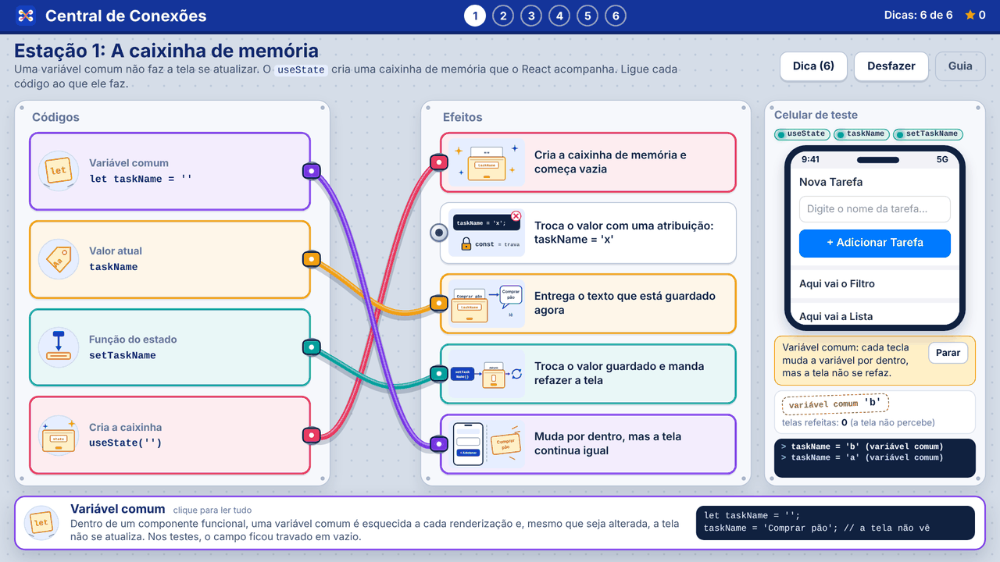
</p>

<p align="center">
  <b>Ligue cada código ao que ele faz e veja o celular de teste ganhar vida.</b><br>
  Um jogo educativo que ensina o componente <code>TaskInput</code> do React Native com cabos, sem perguntas de múltipla escolha.
</p>

<p align="center">
  
  
  
  
  
  
</p>

<p align="center">
  <a href="#sobre">Sobre</a> ·
  <a href="#veja-funcionando">Veja funcionando</a> ·
  <a href="#como-se-joga">Como se joga</a> ·
  <a href="#modos-e-opções">Modos</a> ·
  <a href="#regras-e-pontuação">Regras</a> ·
  <a href="#as-seis-estações">Estações</a> ·
  <a href="#como-executar">Como executar</a> ·
  <a href="#para-quem-conduz-a-atividade">Para quem conduz</a> ·
  <a href="#estrutura-do-projeto">Estrutura</a> ·
  <a href="#como-personalizar">Personalizar</a> ·
  <a href="#autoria">Autoria</a>
</p>

---

## Sobre

A **Central de Conexões do TaskInput** é uma mesa de ligações. À esquerda ficam os **códigos** de um componente real, o campo de *Nova tarefa* de um app de lista de tarefas em React Native com TypeScript. À direita ficam os **efeitos** que cada código provoca. Quem joga liga um ao outro com um **cabo**, e cada ligação certa conserta uma parte do **celular de teste** que fica ao lado: um LED acende, o campo passa a funcionar e alguns códigos mostram de propósito um defeito, como um campo que trava ou um alerta que aparece cedo demais.

Em cada estação sobra um efeito que não pertence a nenhum código, a **isca**. Ela parece certa e existe para o erro acontecer: a janela *Cabo desligado* mostra qual ligação falhou e explica o que o código realmente faz. Errar não tira nada do jogo, só reduz as estrelas da estação.

São seis estações e 24 códigos, do `useState` até a montagem dos dois arquivos com `export` e `import`.

| Em números | |
|---|---|
| Estações | 6 |
| Códigos | 24 |
| Efeitos | 30 (24 certos e 6 iscas) |
| Ilustrações desenhadas em SVG | 54 (24 ícones de código e 30 cenas de efeito) |
| Demonstrações no celular de teste | 7 |
| Fichas de conceito | 24 |
| Passos do tutorial | 6 |
| Ligações erradas verificadas | 96 |
| Dependências | 0 |
| Tamanho dos arquivos do jogo | cerca de 175 KB |

Funciona **offline**, abre com um duplo clique em `index.html`, não faz nenhuma requisição externa e não grava nada no navegador.

---

## Veja funcionando

<p align="center">
  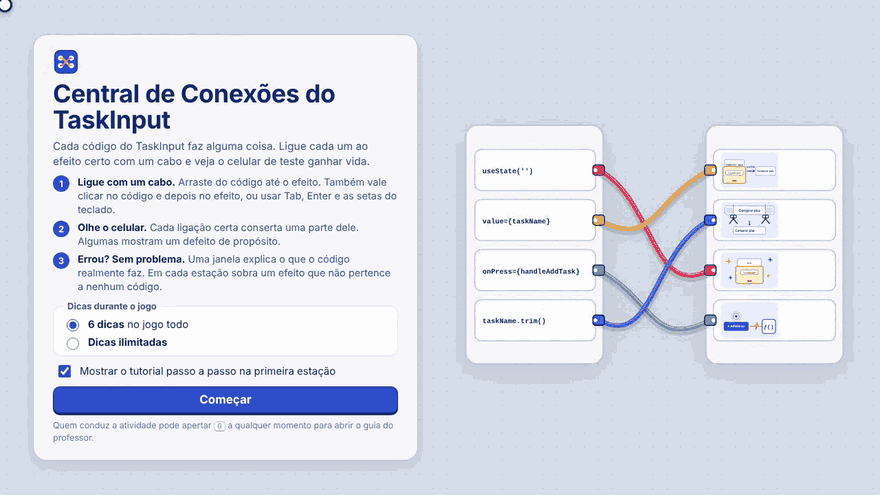
</p>

<p align="center"><sub>Uma partida da estação 1: um cabo certo, uma ligação com a isca, a janela que explica o erro, os cabos restantes e a estação concluída.</sub></p>

---

## O que o jogo ensina

O conteúdo gira em torno de um único componente, o `TaskInput`, o campo de *Nova tarefa* com botão **+ Adicionar Tarefa**. Cada estação isola um pedaço dele.

| Estação | Tema | Códigos em jogo |
|---|---|---|
| **1. A caixinha de memória** | `useState` e a diferença para uma variável comum | `useState('')`<br>`taskName`<br>`setTaskName`<br>`let taskName = ''` |
| **2. Os dois fios do campo** | Campo controlado: `value`, `onChangeText` e `placeholder` | `value={taskName}`<br>`onChangeText={setTaskName}`<br>`value={taskName} // sem onChangeText`<br>`placeholder= "Digite o nome da tarefa..."` |
| **3. O botão que escuta o toque** | O evento `onPress` e os componentes tocáveis `TouchableOpacity` e `Pressable` | `onPress={handleAddTask}`<br>`onPress={handleAddTask()}`<br>`<TouchableOpacity>`<br>`<Pressable>` |
| **4. Os alertas na tela** | `Alert.alert` e como ele se comporta no celular e na web | `Alert.alert('Erro', 'Por favor, digite...')`<br>`Alert.alert( 'Tarefa digitada', trimmedName)`<br>`Alert.alert(title, message) // sem terceiro argumento`<br>`Alert.alert(...) // react-native-web` |
| **5. O porteiro da validação** | Validação: `trim()`, `if`, cláusula de guarda e limpeza do campo | `const trimmedName = taskName.trim();`<br>`if (!trimmedName) { ... }`<br>`Alert.alert('Erro', '...'); return;`<br>`Alert.alert(...); setTaskName('');` |
| **6. A montagem dos dois arquivos** | Montagem: `export`, `import`, JSX e `React.FC` | `export const TaskInput`<br>`import { TaskInput } from '../components/TaskInput'`<br>`<TaskInput />`<br>`export const TaskInput: React.FC = () => {` |

---

## Como se joga

### 1. Escolha como começar

A tela inicial resume o jogo em três passos e pede duas escolhas: quantas dicas haverá e se o tutorial deve aparecer. Os detalhes estão em [Modos e opções](#modos-e-opções).

<p align="center">
  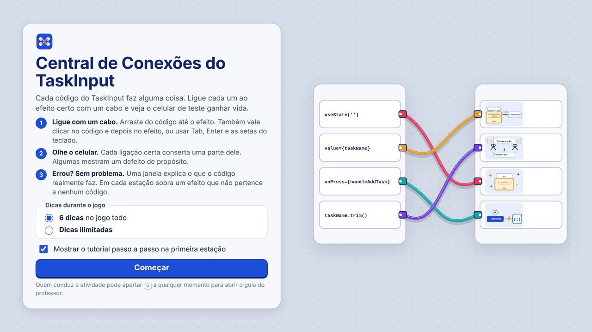
</p>

### 2. Ligue os códigos aos efeitos

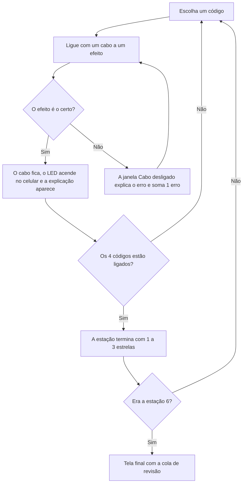

### 3. Conheça a tela

<p align="center">
  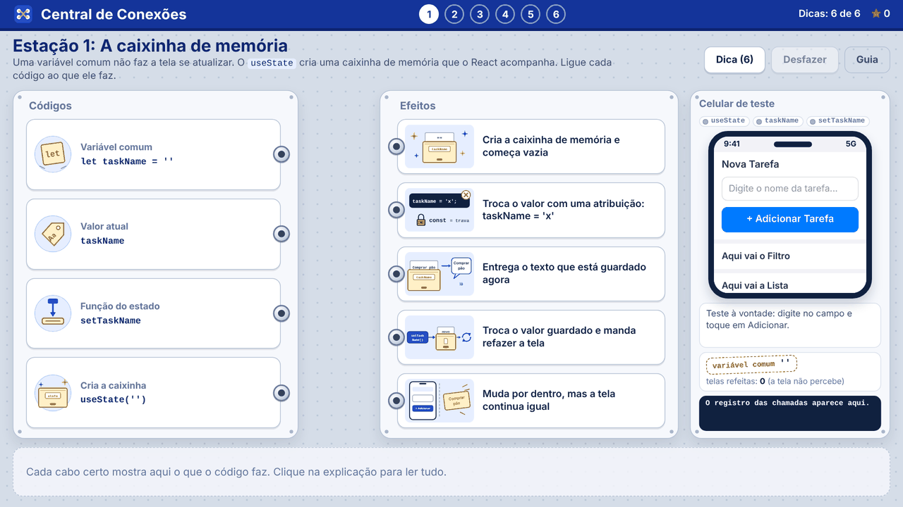
</p>

| Parte da tela | Para que serve |
|---|---|
| **Barra superior** | Mostra as seis estações (a atual em destaque e as feitas em verde), as dicas que restam e o total de estrelas. |
| **Missão** | Uma frase que diz o que a estação trabalha. |
| **Dica, Desfazer e Guia** | Pedem uma pista, retiram o último cabo e abrem o guia do professor. |
| **Códigos** (esquerda) | Quatro trechos de código, cada um com um ícone e um plugue. |
| **Efeitos** (meio) | Cinco efeitos com uma cena desenhada. Um deles é a isca. |
| **Celular de teste** (direita) | LEDs com o nome de cada peça, o celular, uma legenda, o estado (`taskName`) e o registro das chamadas. |
| **Faixa de explicação** (embaixo) | Mostra o que o último cabo certo faz. Clicar nela abre a ficha completa do conceito. |

### 4. Três jeitos de ligar

| Jeito | Como fazer |
|---|---|
| **Arrastar** | Segure o plugue de um código (ou de um efeito) e solte sobre o plugue do outro lado. |
| **Clicar e clicar** | Clique em um código e depois no efeito. Clicar de novo no mesmo cartão cancela a escolha. |
| **Teclado** | <kbd>Tab</kbd> até um cartão, <kbd>Enter</kbd> para escolher, as setas para chegar ao outro lado e <kbd>Enter</kbd> para ligar. |

### 5. Quando o cabo está errado

O cabo não fica. Abre a janela **Cabo desligado**, com o ícone do código, o efeito escolhido e uma explicação. Há dois casos:

- **Isca:** o efeito não pertence a nenhum código da estação. A janela diz por que ele engana (por exemplo, que `trim()` só mexe nas pontas do texto).
- **Troca:** o efeito é de outro código. A janela lembra o que o código escolhido realmente faz.

<p align="center">
  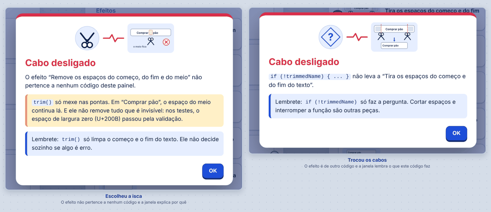
</p>

### 6. Quando o cabo está certo

O cabo fica com uma cor própria, o LED correspondente acende e o celular passa a se comportar de outro jeito. A faixa de baixo mostra o que o código faz e, ao clicar nela, abre a **ficha do conceito**. Quando o quarto cabo é ligado, a estação termina e a janela de conclusão mostra as estrelas, os erros, as dicas usadas e o resumo das quatro ligações.

<p align="center">
  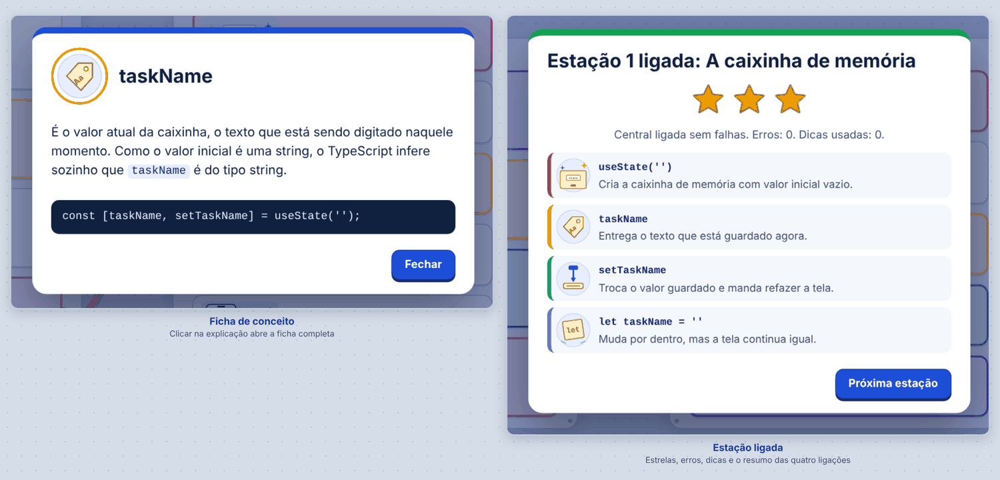
</p>

---

## Modos e opções

As escolhas são feitas na tela inicial, antes de começar.

| Modo | Como ativar | O que muda |
|---|---|---|
| **6 dicas** (padrão) | Já vem marcado | Há 6 dicas no jogo todo. O alto da tela mostra `Dicas: 6 de 6` e o botão mostra `Dica (6)`. Quando acabam, aparece o aviso *As dicas acabaram*. |
| **Dicas ilimitadas** | Marcar *Dicas ilimitadas* | As dicas nunca acabam. O alto mostra `Dicas ilimitadas` e o botão fica só `Dica`. Cada dica continua entrando na pontuação da estação. |
| **Com tutorial** (padrão) | Já vem marcado | Um passo a passo guia a primeira ligação da estação 1. As dicas pedidas durante o tutorial são grátis. |
| **Sem tutorial** | Desmarcar a caixa | O jogo começa direto na estação 1. |
| **Conduzido** | Tecla <kbd>G</kbd> a qualquer momento | Abre o guia do professor, que também pode ser aberto na tela inicial e na tela final. Veja [Para quem conduz a atividade](#para-quem-conduz-a-atividade). |

### Dicas

<p align="center">
  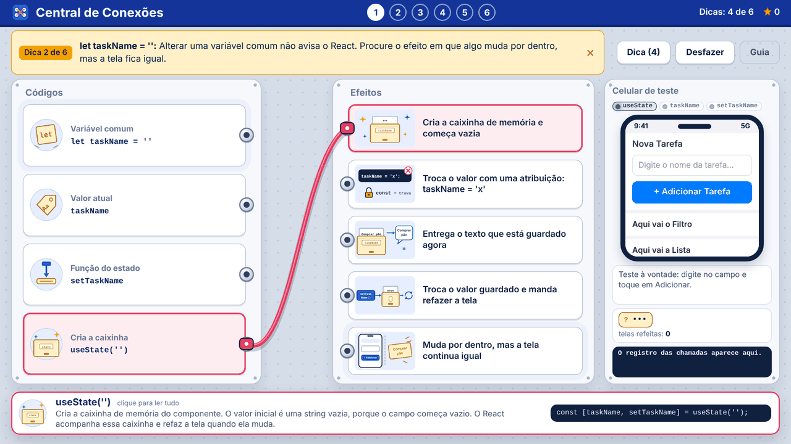
</p>

- A dica vale para o **código selecionado**. Sem seleção, vale para o **primeiro código ainda sem cabo**.
- Cada código tem duas dicas pagas. A primeira é uma pista. A segunda é a **pista forte**, que também faz o efeito certo pulsar.
- Uma terceira dica sobre o mesmo código é **grátis** e repete a pista forte.
- A faixa amarela mostra a pista e some ao clicar em **×**.

### Tutorial

O tutorial aparece em uma caixa na parte de baixo da tela, com o elemento do passo destacado em laranja, e **bloqueia o que não faz parte do passo**: no passo do primeiro cabo só os dois cartões indicados funcionam, e nos demais as ligações ficam travadas até a ação pedida. A qualquer momento, **Pular tutorial** libera tudo.

| Passo | O que pede |
|---|---|
| 1 de 6 | Apresenta a tela. Botão **Próximo**. |
| 2 de 6 | Ligar `useState('')` a "Cria a caixinha de memória e começa vazia". |
| 3 de 6 | Digitar qualquer coisa no campo do celular de teste. |
| 4 de 6 | Clicar em **Dica**. Não conta. |
| 5 de 6 | Apresenta o botão **Desfazer**. Botão **Próximo**. |
| 6 de 6 | Pede para ligar os outros três códigos. Botão **Começar a jogar**. |

<p align="center">
  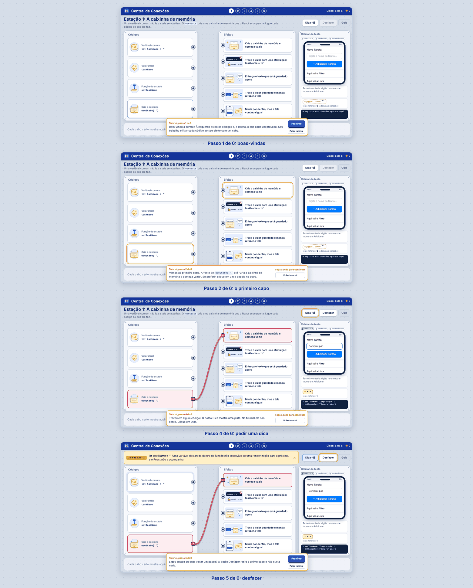
</p>

---

## Regras e pontuação

1. **Seis estações, 24 códigos.** Cada estação tem 4 códigos na coluna da esquerda e 5 efeitos na da direita. As estações vão de 1 a 6, sempre nessa ordem.
2. **Um código, um efeito.** Cada código tem exatamente um efeito certo. O quinto efeito de cada estação é a **isca** e não pertence a nenhum código.
3. **Só o cabo certo fica.** Na ligação certa o cabo permanece, o LED acende no celular e a explicação aparece embaixo. Na ligação errada o cabo não fica, a janela explica o erro e a partida continua de onde estava.
4. **Todo erro conta, nenhum erro tira nada.** Cada ligação errada soma 1 erro na estação. Os erros só reduzem estrelas: não travam o jogo nem gastam dicas.
5. **A estação termina sozinha.** A janela de conclusão abre 1,4 segundo depois do quarto cabo certo. A isca fica sem cabo.
6. **Dicas custam estrelas.** Cada dica paga soma 1 na penalidade da estação, tanto no modo de 6 dicas quanto no ilimitado. As dicas do tutorial e a terceira dica sobre o mesmo código são grátis.
7. **Desfazer é grátis.** Retira o último cabo certo e não conta erro nem dica.
8. **Sem cronômetro e sem sorteio.** Não há limite de tempo. A ordem dos cartões é fixa, igual em toda partida, e no máximo um código fica na mesma altura do seu efeito certo.
9. **Nada é salvo.** Recarregar a página volta ao início.

### Estrelas de cada estação

A penalidade é a soma dos **erros** com as **dicas pagas** da estação.

| Erros + dicas | Estrelas |
|---|---|
| 0 ou 1 | 3 |
| 2 a 4 | 2 |
| 5 ou mais | 1 |

Toda estação concluída rende pelo menos 1 estrela.

### Resultado final

O total é de até **18 estrelas** (6 estações com 3 cada). As estrelas grandes da tela final seguem a média por estação.

| Média por estação | Estrelas grandes |
|---|---|
| 2,5 ou mais | 3 |
| 1,75 até menos de 2,5 | 2 |
| menos de 1,75 | 1 |

<p align="center">
  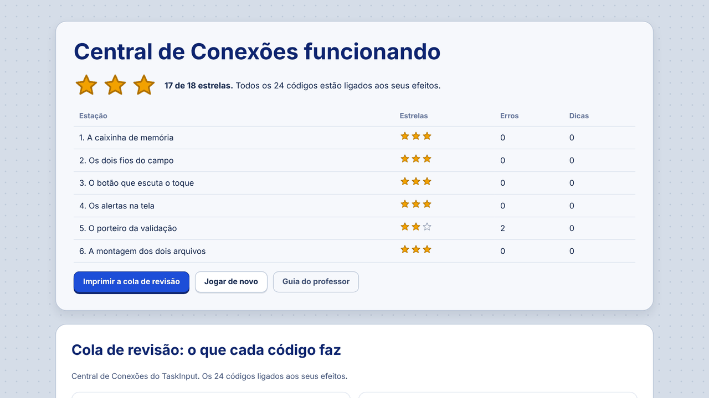
</p>

---

## As seis estações

Cada estação tem um tema, uma missão e uma isca. Os gabaritos estão recolhidos para não estragar a surpresa de quem só quer ler o README.

### Estação 1: A caixinha de memória

> Uma variável comum não faz a tela se atualizar. O `useState` cria uma caixinha de memória que o React acompanha. Ligue cada código ao que ele faz.

LEDs do celular de teste: `useState`, `taskName`, `setTaskName`.

<details>
<summary>Ver a estação 1 ligada e o gabarito</summary>

<p align="center">
  
</p>

| Código | Liga a | No celular |
|---|---|---|
| `useState('')` | Cria a caixinha de memória e começa vazia | acende o LED `useState` |
| `taskName` | Entrega o texto que está guardado agora | acende o LED `taskName` |
| `setTaskName` | Troca o valor guardado e manda refazer a tela | acende o LED `setTaskName` |
| `let taskName = ''` | Muda por dentro, mas a tela continua igual | demonstração: as teclas mudam a variável e a tela não se refaz |

**A isca:** “Troca o valor com uma atribuição: taskName = 'x'”. Atribuir direto não funciona: `taskName` é uma constante e o TypeScript recusa a linha. O único jeito de alterar o valor é chamar `setTaskName`.

</details>

### Estação 2: Os dois fios do campo

> Um campo controlado tem dois fios ligados ao estado: um para mostrar o valor e outro para escutar o que foi digitado. Ligue cada código ao que ele provoca.

LEDs do celular de teste: `value`, `onChangeText`, `placeholder`.

<details>
<summary>Ver a estação 2 ligada e o gabarito</summary>

<p align="center">
  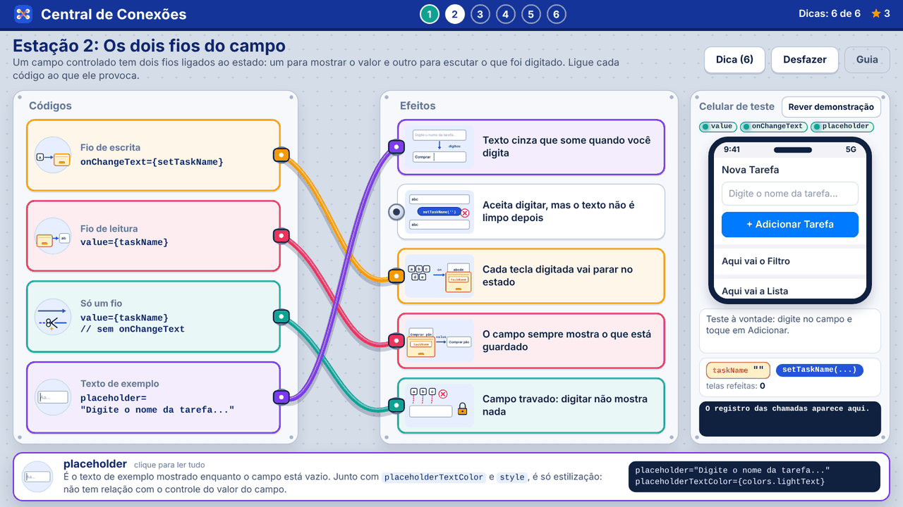
</p>

| Código | Liga a | No celular |
|---|---|---|
| `value={taskName}` | O campo sempre mostra o que está guardado | acende o LED `value` |
| `onChangeText={setTaskName}` | Cada tecla digitada vai parar no estado | acende o LED `onChangeText` |
| `value={taskName} // sem onChangeText` | Campo travado: digitar não mostra nada | demonstração: o campo trava e nada aparece ao digitar |
| `placeholder= "Digite o nome da tarefa..."` | Texto cinza que some quando você digita | acende o LED `placeholder` |

**A isca:** “Aceita digitar, mas o texto não é limpo depois”. Isso acontece com `defaultValue` no lugar de `value`: o campo deixa de ser controlado. Digitar funciona, mas `setTaskName('')` não esvazia a tela. Nos testes, “abc” continuou no campo depois do toque.

</details>

### Estação 3: O botão que escuta o toque

> O botão precisa executar a função só quando o dedo toca nele. Ligue cada código ao comportamento que ele cria.

LEDs do celular de teste: `onPress`, `TouchableOpacity`.

<details>
<summary>Ver a estação 3 ligada e o gabarito</summary>

<p align="center">
  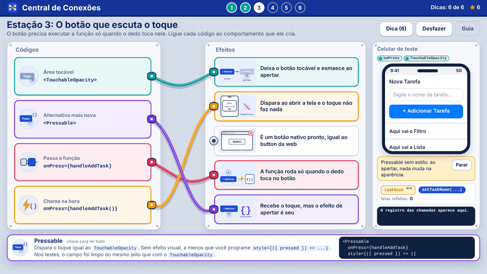
</p>

| Código | Liga a | No celular |
|---|---|---|
| `onPress={handleAddTask}` | A função roda só quando o dedo toca no botão | acende o LED `onPress` |
| `onPress={handleAddTask()}` | Dispara ao abrir a tela e o toque não faz nada | demonstração: o alerta de erro aparece ao abrir a tela e o toque não faz nada |
| `<TouchableOpacity>` | Deixa o botão tocável e esmaece ao apertar | acende o LED `TouchableOpacity` |
| `<Pressable>` | Recebe o toque, mas o efeito de apertar é seu | demonstração: o botão não muda de aparência ao apertar |

**A isca:** “É um botão nativo pronto, igual ao button da web”. O React Native não tem um elemento de botão nativo tão simples de estilizar quanto o da web. Por isso o padrão é envolver o conteúdo visual em um componente tocável, como `TouchableOpacity` ou `Pressable`.

</details>

### Estação 4: Os alertas na tela

> Os alertas são a resposta do componente a quem toca no botão. Ligue cada chamada ao que a pessoa vê.

LEDs do celular de teste: `alerta de erro`, `alerta de confirmação`.

<details>
<summary>Ver a estação 4 ligada e o gabarito</summary>

<p align="center">
  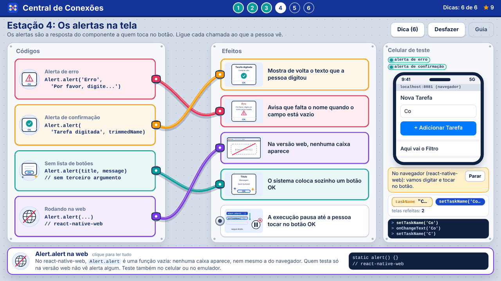
</p>

| Código | Liga a | No celular |
|---|---|---|
| `Alert.alert('Erro', 'Por favor, digite...')` | Avisa que falta o nome quando o campo está vazio | acende o LED `alerta de erro` |
| `Alert.alert( 'Tarefa digitada', trimmedName)` | Mostra de volta o texto que a pessoa digitou | acende o LED `alerta de confirmação` |
| `Alert.alert(title, message) // sem terceiro argumento` | O sistema coloca sozinho um botão OK | demonstração: o alerta ganha um botão OK sem ninguém pedir |
| `Alert.alert(...) // react-native-web` | Na versão web, nenhuma caixa aparece | demonstração: a função roda e nenhuma caixa aparece |

**A isca:** “A execução pausa até a pessoa tocar no botão OK”. `Alert.alert` não bloqueia: ele devolve o controle na hora e a linha seguinte roda sem esperar o OK. Por isso `setTaskName('')` já limpa o campo logo depois de chamar o alerta.

</details>

### Estação 5: O porteiro da validação

> Antes de aceitar uma tarefa, o componente confere o texto. Ligue cada trecho do porteiro ao que ele faz.

LEDs do celular de teste: `trim()`, `if`, `return`, `setTaskName('')`.

<details>
<summary>Ver a estação 5 ligada e o gabarito</summary>

<p align="center">
  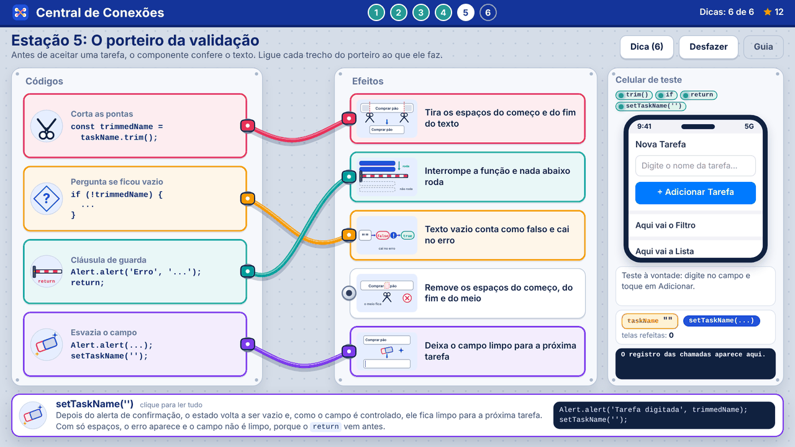
</p>

| Código | Liga a | No celular |
|---|---|---|
| `const trimmedName = taskName.trim();` | Tira os espaços do começo e do fim do texto | acende o LED `trim()` |
| `if (!trimmedName) { ... }` | Texto vazio conta como falso e cai no erro | acende o LED `if` |
| `Alert.alert('Erro', '...'); return;` | Interrompe a função e nada abaixo roda | acende o LED `return` |
| `Alert.alert(...); setTaskName('');` | Deixa o campo limpo para a próxima tarefa | acende o LED `setTaskName('')` |

**A isca:** “Remove os espaços do começo, do fim e do meio”. `trim()` só mexe nas pontas. Em “Comprar pão”, o espaço do meio continua lá. E ele não remove tudo que é invisível: nos testes, o espaço de largura zero (U+200B) passou pela validação.

</details>

### Estação 6: A montagem dos dois arquivos

> Dois arquivos precisam se encaixar: o `TaskInput.tsx` oferece e a `HomeScreen.tsx` usa. Ligue cada peça à sua função.

LEDs do celular de teste: `export`, `import`, `<TaskInput />`.

<details>
<summary>Ver a estação 6 ligada e o gabarito</summary>

<p align="center">
  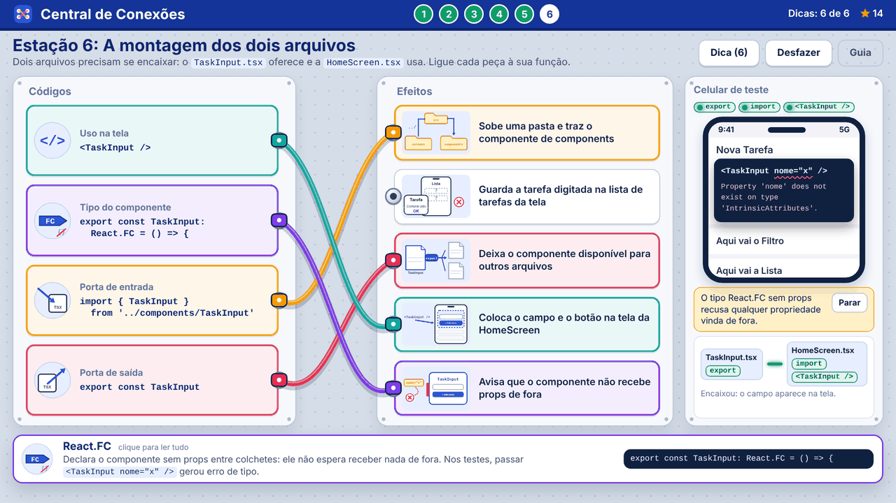
</p>

| Código | Liga a | No celular |
|---|---|---|
| `export const TaskInput` | Deixa o componente disponível para outros arquivos | acende o LED `export` |
| `import { TaskInput } from '../components/TaskInput'` | Sobe uma pasta e traz o componente de components | acende o LED `import` |
| `<TaskInput />` | Coloca o campo e o botão na tela da HomeScreen | acende o LED `<TaskInput />` |
| `export const TaskInput: React.FC = () => {` | Avisa que o componente não recebe props de fora | demonstração: o TypeScript recusa `<TaskInput nome="x" />` |

**A isca:** “Guarda a tarefa digitada na lista de tarefas da tela”. Ainda não existe lista: por enquanto o `TaskInput` só mostra um alerta com o texto e limpa o campo. Conectar o componente de verdade ao estado da lista é um passo seguinte do projeto.

</details>

---

## O celular de teste

O celular que fica ao lado das colunas é um **TaskInput de verdade** (campo *Nova Tarefa*, botão **+ Adicionar Tarefa** e alertas) que se comporta de acordo com o que já foi ligado. Dá para digitar nele e tocar em Adicionar a qualquer momento.

- Os **LEDs** acima do celular têm o nome de cada peça da estação e acendem quando o cabo certo é ligado.
- O **estado** (`taskName` e `setTaskName(...)`), o contador de **telas refeitas** e o **registro das chamadas** mostram o que acontece por dentro.
- Sete códigos disparam uma **demonstração**: o celular repete o defeito sozinho, com uma legenda. O botão **Parar** interrompe e **Rever demonstração** repete.

<p align="center">
  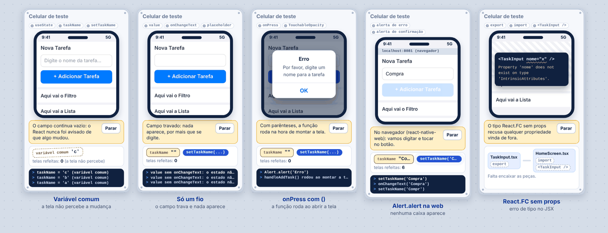
</p>

| Código | O que a demonstração mostra |
|---|---|
| `let taskName = ''` | Cada tecla muda a variável por dentro, mas a tela não se refaz. O contador de telas refeitas fica em 0. |
| `value={taskName} // sem onChangeText` | O campo trava: por mais que se digite, nada aparece. |
| `onPress={handleAddTask()}` | A função roda ao abrir a tela (o alerta de erro aparece sem ninguém tocar) e depois o botão recebe `undefined`. |
| `<Pressable>` | Ao apertar, nada muda na aparência. Com `style={({ pressed }) => ...}` o efeito aparece, mas quem programa é você. |
| `Alert.alert(title, message) // sem terceiro argumento` | O sistema coloca sozinho um botão OK. |
| `Alert.alert(...) // react-native-web` | No navegador, a função é chamada e nenhuma caixa aparece. |
| `export const TaskInput: React.FC = () => {` | O TypeScript recusa `<TaskInput nome="x" />`, porque o tipo não aceita props de fora. |

---

## Catálogo de ilustrações

Nenhuma imagem é carregada de fora. Os 24 ícones de código e as 30 cenas de efeito, além do logotipo e das estrelas, são SVG escrito à mão em `ilustracoes.js`. As bordas vermelhas tracejadas marcam as iscas.

<p align="center">
  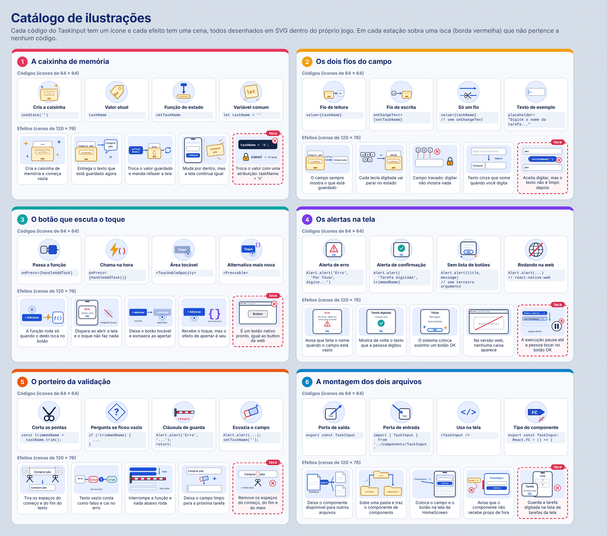
</p>

---

## Recursos

- **Ligação por arrastar, clicar ou teclado**, com cabos curvos desenhados em SVG, cada um com uma cor própria.
- **Celular de teste** que reage a cada ligação e repete defeitos reais em sete demonstrações.
- **Janela de erro que ensina**, com a isca de cada estação explicada.
- **Fichas de conceito** para os 24 códigos, abertas ao clicar na faixa de explicação.
- **Dicas em dois níveis**, limitadas ou ilimitadas, e **tutorial** de seis passos que pode ser pulado.
- **Desfazer** gratuito, por botão ou pela tecla <kbd>Z</kbd>.
- **Pontuação** por estrelas, por estação e no total.
- **Guia do professor** com objetivo, sugestões de condução, gabarito, pontos de atenção e perguntas para discutir.
- **Cola de revisão** pronta para imprimir, com os 24 códigos, seus efeitos e as ilustrações.
- **Acessível** pelo teclado, com anúncios para leitores de tela e respeito ao movimento reduzido.
- **Funciona offline**, sem servidor, sem build e sem dependências.

---

## Como executar

**Pelo navegador, sem instalar nada**

1. Baixe o repositório em **Code > Download ZIP** e extraia a pasta.
2. Dê um duplo clique em `index.html`.

Não precisa de servidor, de internet nem de build. Os scripts são clássicos (variáveis em `window`), por isso funcionam também abertos direto do disco.

**Com o Git**

```bash
git clone https://github.com/alecondedias/Central_Conexoes_TaskInput.git
cd Central_Conexoes_TaskInput
```

Depois abra `index.html` no navegador.

**Para publicar com o GitHub Pages**

No repositório, abra **Settings > Pages**, escolha **Deploy from a branch**, selecione a branch principal e a pasta `/ (root)`. Em alguns minutos o endereço aparece nessa mesma página.

**Para projetar em sala**

Use a tela cheia do navegador (<kbd>F11</kbd>). A partir de 1280 por 720 pixels o jogo inteiro cabe na tela, sem rolagem.

**Navegadores**

O jogo foi desenvolvido e testado no Chromium (base do Chrome e do Edge). Ele usa só recursos padrão (CSS Grid, flexbox, variáveis CSS, SVG embutido), mas Firefox e Safari não foram testados.

---

## Controles e atalhos

| Ação | Como fazer |
|---|---|
| Ligar um cabo | Arrastar de um plugue ao outro, ou clicar no código e depois no efeito, ou <kbd>Enter</kbd> ou <kbd>Espaço</kbd> no cartão e depois no outro |
| Navegar entre cartões | <kbd>Tab</kbd> e <kbd>Shift</kbd>+<kbd>Tab</kbd>. <kbd>↓</kbd> e <kbd>↑</kbd> andam pela mesma coluna e <kbd>→</kbd> (nos códigos) ou <kbd>←</kbd> (nos efeitos) passam para a outra coluna |
| Cancelar a escolha | Clicar de novo no cartão, clicar fora ou <kbd>Esc</kbd> |
| Pedir uma dica | <kbd>H</kbd> ou o botão **Dica** |
| Desfazer o último cabo | <kbd>Z</kbd> ou o botão **Desfazer** |
| Abrir o guia do professor | <kbd>G</kbd> ou o botão **Guia** |
| Fechar uma janela (erro, ficha ou guia) | <kbd>Esc</kbd> ou o botão da janela |
| Pular direto para o painel | Link **Ir para o painel de ligações**, que aparece com o primeiro <kbd>Tab</kbd> |

Os atalhos de letra não funcionam com <kbd>Ctrl</kbd>, <kbd>Alt</kbd> ou <kbd>Cmd</kbd> pressionados nem enquanto se digita em um campo, como o do celular de teste. Com uma janela aberta, <kbd>H</kbd> e <kbd>Z</kbd> ficam desativados.

---

## Para quem conduz a atividade

Aperte <kbd>G</kbd> (ou clique em **Guia**) para abrir o guia do professor. Ele funciona na tela inicial, durante o jogo e na tela final.

<p align="center">
  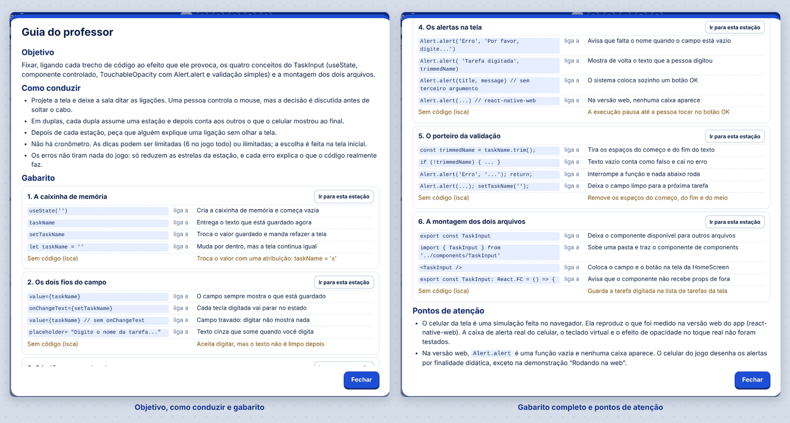
</p>

**Objetivo.** Fixar, ligando cada trecho de código ao efeito que ele provoca, os quatro conceitos do TaskInput (useState, componente controlado, TouchableOpacity com Alert.alert e validação simples) e a montagem dos dois arquivos.

**Como conduzir**

- Projete a tela e deixe a sala ditar as ligações. Uma pessoa controla o mouse, mas a decisão é discutida antes de soltar o cabo.
- Em duplas, cada dupla assume uma estação e depois conta aos outros o que o celular mostrou ao final.
- Depois de cada estação, peça que alguém explique uma ligação sem olhar a tela.
- Não há cronômetro. As dicas podem ser limitadas (6 no jogo todo) ou ilimitadas; a escolha é feita na tela inicial.
- Os erros não tiram nada do jogo: só reduzem as estrelas da estação, e cada erro explica o que o código realmente faz.

**Perguntas para discutir**

1. O que muda se trocarmos `value` por `defaultValue`? Teste no celular ao ligar só um dos fios.
2. Por que `onPress={handleAddTask()}` mostra o alerta de erro assim que a tela abre?
3. Se retirarmos o `return` do porteiro, o que a pessoa vê quando toca com o campo vazio?
4. Por que o texto “Comprar pão” continua com o espaço do meio depois do `trim()`?

<details>
<summary>Pontos de atenção do guia</summary>

- O celular da tela é uma simulação feita no navegador. Ela reproduz o que foi medido na versão web do app (react-native-web). A caixa de alerta real do celular, o teclado virtual e o efeito de opacidade no toque real não foram testados.
- Na versão web, `Alert.alert` é uma função vazia e nenhuma caixa aparece. O celular do jogo desenha os alertas por finalidade didática, exceto na demonstração “Rodando na web”.
- `trim()` remove espaços, tabs, quebras de linha e espaço sem quebra, mas não remove o espaço de largura zero (U+200B): esse caso passa pela validação.
- `Alert.alert` não bloqueia a execução: a linha seguinte roda sem esperar o OK. Por isso o campo já está limpo quando o alerta aparece.
- Com só espaços, o erro aparece e o campo não é limpo, porque o `return` acontece antes do `setTaskName('')`.
- Com `value` e sem `onChangeText`, o campo trava. Com `defaultValue` no lugar de `value`, digitar funciona, mas o campo não é limpo pelo `setTaskName('')`.
- `TouchableOpacity` não está marcado como obsoleto na documentação, mas ela recomenda `Pressable` como opção mais completa. O `SafeAreaView` importado de `react-native` (usado na HomeScreen dos slides) é obsoleto desde o React Native 0.81.

</details>

**Durante o jogo**, cada estação do gabarito tem um botão **Ir para esta estação**, útil para retomar um ponto específico. Ele reinicia a estação escolhida. Veja o efeito disso nos [limites conhecidos](#limites-conhecidos).

**Cola de revisão.** A tela final traz a **cola de revisão**, com os 24 códigos, o que cada um faz e as ilustrações. O botão **Imprimir a cola de revisão** abre a impressão com só a cola (3 páginas A4 no Chromium).

<p align="center">
  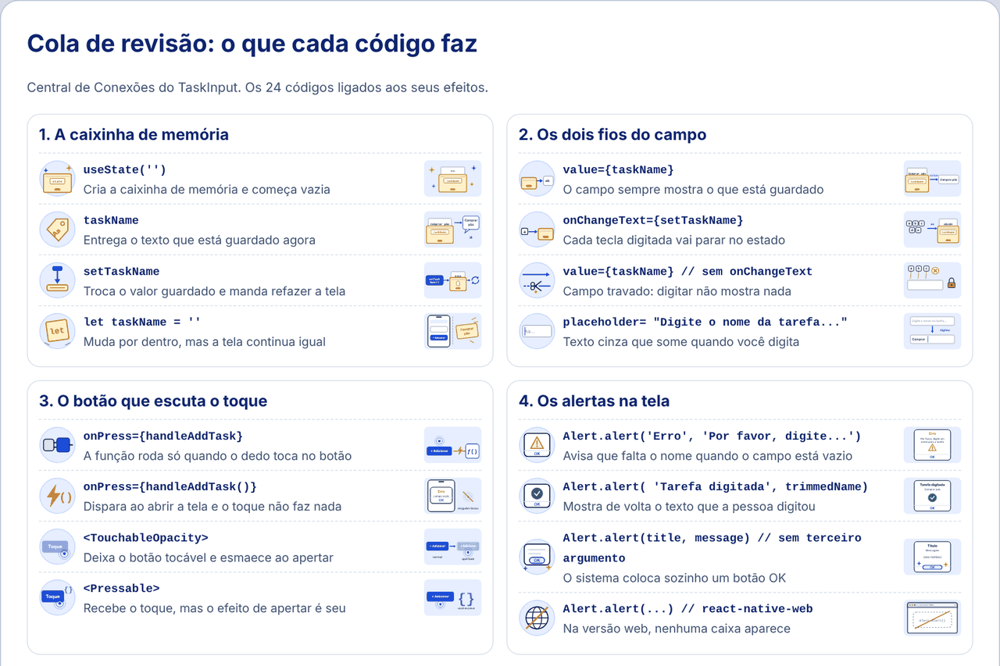
</p>

---

## Acessibilidade e telas

- **Teclado:** toda a ligação, as dicas, o desfazer, as janelas, o tutorial e o guia funcionam sem mouse. O foco é visível e fica preso dentro das janelas abertas.
- **Leitores de tela:** a escolha de um cartão, as ligações certas e erradas, o desfazer, as dicas, os passos do tutorial e as mudanças de estação são anunciados por regiões `aria-live`.
- **Movimento reduzido:** com `prefers-reduced-motion` ativo, as animações e transições são desligadas.
- **Toque:** em telas sensíveis ao toque, o arrastar começa pelo plugue do cartão, e tocar em um cartão e depois no outro funciona em qualquer ponto dele.
- **Telas pequenas:** em telas de até 1180 px de largura o celular de teste passa para baixo das colunas e a explicação deixa de ficar presa ao rodapé, então a página rola. Em telas de até 560 px as ilustrações dos cartões somem para sobrar espaço ao texto.

<p align="center">
  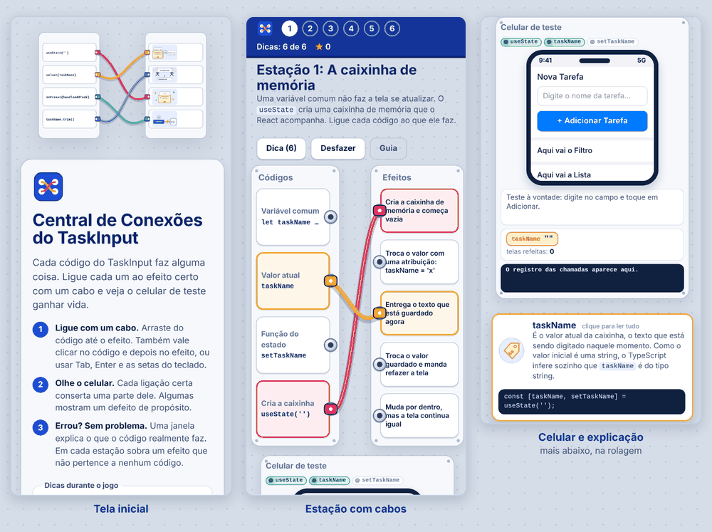
</p>

Medido no Chromium, com o jogo aberto em cada tamanho de janela:

| Tela (largura x altura em px) | Tela inicial | Jogo |
|---|---|---|
| 1920x1080, 1920x947, 2560x1440, 1536x730, 1366x768, 1280x720, 1280x800 | Cabe, sem rolagem | Cabe, sem rolagem |
| 1440x900 | Rola 6 px | Cabe, sem rolagem |
| 1366x657 | Cabe, sem rolagem | Rola 57 px |
| 1280x600 | Rola 51 px | Rola 114 px |
| 1180x820, 1133x744, 1100x700, 1024x768, 820x1180 | Cabe, sem rolagem | Rola de 98 a 578 px |
| 844x390, 390x844, 360x640 | Rola de 279 a 611 px | Rola de 529 a 888 px |

Em nenhum tamanho houve rolagem horizontal nem cartão fora da tela.

---

## Estrutura do projeto

```text
.
├── index.html        Estrutura das telas (início, jogo, final) e ordem dos scripts
├── estilos.css       Todo o visual: cores, layout, janelas, responsivo, movimento reduzido e impressão
├── dados.js          Todo o conteúdo: estações, códigos, efeitos, iscas, dicas, fichas e guia
├── ilustracoes.js    Os 24 ícones, as 30 cenas, o logotipo, o desenho da tela inicial e as estrelas (SVG)
├── celular.js        O celular de teste: o TaskInput simulado, os LEDs e as 7 demonstrações
├── jogo.js           A tela e o estado: ligação, cabos, dicas, tutorial, janelas, pontuação e telas
├── testes/
│   └── verificar.js  Confere os dados do jogo (Node, sem dependências)
├── imagens/          Capturas de tela, GIF e colagens usadas neste README
├── package.json      Atalho para rodar o teste com npm test
└── README.md
```

| Arquivo | Linhas | Tamanho |
|---|---|---|
| `jogo.js` | 1195 | 40 KB |
| `estilos.css` | 2256 | 36 KB |
| `dados.js` | 628 | 35 KB |
| `ilustracoes.js` | 856 | 37 KB |
| `celular.js` | 601 | 20 KB |
| `index.html` | 125 | 5 KB |
| `testes/verificar.js` | 87 | 4 KB |

<details>
<summary>Imagens deste README</summary>

| Arquivo | O que mostra |
|---|---|
| `logo.svg` | Logotipo do jogo |
| `estacao-1.png` a `estacao-6.png` | Cada estação com todos os cabos ligados |
| `estacao-1-vazia.png` | A estação 1 antes da primeira ligação |
| `capa.png` | Tela inicial |
| `jogo-em-acao.gif` | Partida curta da estação 1 |
| `erros.png` | Janelas *Cabo desligado* (isca e troca) |
| `ficha-e-conclusao.png` | Ficha de conceito e janela de estação ligada |
| `tutorial.png` | Passos do tutorial |
| `dica.png` | Faixa de dica |
| `celular-demos.png` | Demonstrações do celular de teste |
| `guia.png` | Guia do professor |
| `tela-final.png` | Resultado final |
| `cola-revisao.png` | Cola de revisão |
| `telefone.png` | Jogo em tela de celular |
| `catalogo.png` | Ícones e cenas |

</details>

---

## Como funciona por dentro

Os scripts são clássicos e se comunicam por objetos globais em `window`. Por isso o jogo abre direto do disco (`file://`), onde módulos ES são bloqueados pelo navegador.

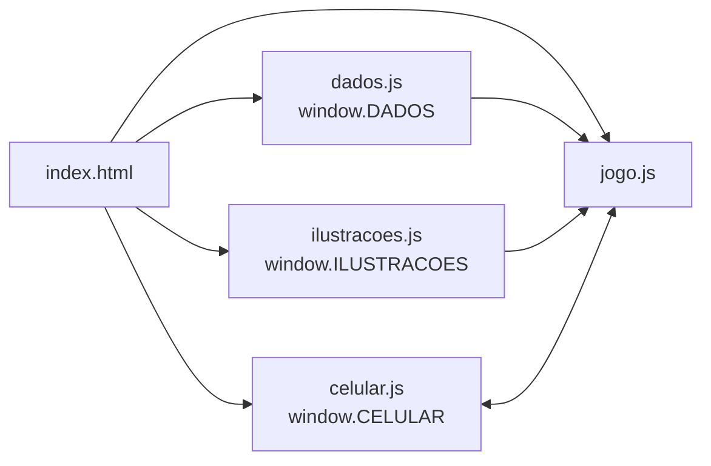

A ordem dos scripts em `index.html` importa: `dados.js`, `ilustracoes.js`, `celular.js` e por último `jogo.js`, que usa os três.

**O que cada arquivo faz**

- `dados.js` guarda **todo o conteúdo das estações**: textos, códigos, efeitos, iscas, dicas, fichas e guia do professor. Os passos do tutorial e as mensagens de aviso ficam em `jogo.js`, as legendas do celular em `celular.js` e o texto da tela inicial em `index.html`.
- `ilustracoes.js` devolve SVG por chave: `ILUSTRACOES.icone("i-usestate")` e `ILUSTRACOES.cena("c-caixa-nasce")`.
- `celular.js` expõe `montar`, `configurar`, `aplicar`, `demo`, `pararDemo`, `reverDemo`, `aoEvento` e `elementos`.
- `jogo.js` cuida do estado da partida, dos cabos (curvas de Bézier em um `<svg>` sobre a mesa), das janelas, do tutorial e da pontuação.

**Como uma ligação vira celular**

Cada estação declara, em `base`, quais peças começam *desligadas* no celular. Cada código declara em `liga` o que acontece quando é ligado direito:

- `liga: { chave: "estado" }` religa a peça `estado` no celular e acende o LED de mesmo nome.
- `liga: { demo: "variavelComum" }` roda uma demonstração (uma função assíncrona de `celular.js`).

A cada ligação, `jogo.js` recalcula a configuração a partir de `base` e dos cabos que existem, e chama `CELULAR.aplicar(...)`. É por isso que **Desfazer** também desliga o LED e o comportamento correspondentes.

**Como é um código nos dados**

```js
{
  id: "1a",
  icone: "i-usestate",            // ícone em ilustracoes.js
  rotulo: "Cria a caixinha",
  codigo: `useState('')`,
  efeito: "1a",                   // id do efeito certo
  liga: { chave: "estado" },      // o que o celular passa a fazer
  dica: "...",                    // dica de nível 1
  dicaForte: "...",               // dica de nível 2
  resumo: "...",                  // linha da janela de conclusão
  pistaErro: "...",               // lembrete na janela de erro
  flash: { titulo: "...", texto: "...", codigo: "..." }  // ficha do conceito
}
```

E um efeito, com a isca marcada:

```js
{ id: "1x", cena: "c-atribui-direto", titulo: "...", isca: true, motivo: "..." }
```

---

## Como personalizar

| Quero mudar | Onde |
|---|---|
| Qualquer texto de estação, código, efeito, dica, ficha ou do guia | `dados.js` |
| O número de dicas | `dicasPadrao` em `dados.js`, o rótulo **6 dicas** em `index.html` e o item "6 no jogo todo" do guia em `dados.js` |
| As cores dos cabos | A lista `cores` em `dados.js` (usadas em rodízio, na ordem em que os cabos são ligados) |
| O visual (cores, fontes, tamanhos) | As variáveis no início de `estilos.css` (`--cobalto`, `--bancada`, `--tinta` e outras) |
| Um ícone ou uma cena | A função correspondente em `ilustracoes.js` |
| O que o celular faz ou uma demonstração | `celular.js` |

**Para criar uma estação nova**

1. Copie um bloco de estação em `dados.js` e troque ids, textos e códigos. Use 4 códigos e 5 efeitos, sendo exatamente 1 isca com `motivo`.
2. Dê a cada código um `icone` e a cada efeito uma `cena` que existam em `ilustracoes.js`, ou desenhe novos.
3. Em `leds`, `base` e `liga.chave`, use chaves que o celular conhece (as de `COMPLETA` em `celular.js`) ou acrescente o comportamento novo lá.
4. Se criar uma demonstração, acrescente a função ao objeto de demonstrações de `celular.js` e use `liga: { demo: "nome" }`.
5. Troque o texto fixo "24 códigos" em `jogo.js` (tela final e cola de revisão) e revise o guia.
6. Rode `npm test`.

---

## Testes e qualidade

**Incluído no repositório**

```bash
npm test
# ou, sem npm:
node testes/verificar.js
```

O script precisa só do Node. Ele confere se cada estação tem 4 códigos, 5 efeitos e exatamente uma isca com motivo, se todo código tem dica, pista de erro, resumo e ficha, e se cada código aponta para um efeito que existe e não é a isca. Também confere se todo ícone, toda cena e toda demonstração citados nos dados existem, e se nenhum ícone ou cena ficou sem uso. A saída esperada é:

```text
OK: 6 estações, 24 códigos, 30 efeitos (6 iscas), 24 ícones e 30 cenas em uso, 120 pares código x efeito (24 certos e 96 errados).
```

**Verificado durante o desenvolvimento**

Estas verificações foram feitas com o jogo aberto no Chromium e automação de navegador. Os scripts não fazem parte do repositório.

- Partida completa das seis estações por arrastar e por teclado (<kbd>Tab</kbd>, <kbd>Enter</kbd> e setas), terminando com 18 de 18 estrelas.
- As **96 ligações erradas** (24 com a isca e 72 trocas): cada uma abre a janela certa e nenhuma deixa cabo preso. Com todas elas feitas, a tela final marca 6 de 18 estrelas.
- Limites das estrelas por estação: 0 e 1 erro dão 3 estrelas, 2 e 4 erros dão 2, 5 erros dão 1. Duas dicas pagas dão 2 estrelas.
- Dicas: contador de 6 até 0 com o aviso de que acabaram, modo ilimitado, pulso do efeito na segunda dica, terceira dica grátis e dica do tutorial sem custo.
- Desfazer por botão e por <kbd>Z</kbd>, atalhos ignorados ao digitar no campo do celular e com o guia aberto.
- Tutorial completo, tutorial pulado e jogo sem tutorial. Guia aberto por <kbd>G</kbd> na tela inicial e na tela final, e o botão **Ir para esta estação**.
- Impressão da cola de revisão (só a cola aparece, em 3 páginas A4) e movimento reduzido.
- Nenhum erro de console, nenhuma requisição externa e nada gravado em `localStorage`, `sessionStorage` ou cookies.
- Ligação por toque em duas etapas nas telas de 390x844, 360x640 e 844x390, e a tabela de tamanhos em [Acessibilidade e telas](#acessibilidade-e-telas).

**Para contribuir**

Sugestões e correções são bem-vindas por *issue* ou *pull request*. Antes de enviar uma mudança em `dados.js`, rode `npm test`.

---

## Limites conhecidos

- **O celular de teste é uma simulação.** Ela reproduz o que foi medido na versão web do app (`react-native-web`). A caixa de alerta nativa do celular, o teclado virtual e o efeito de opacidade no toque real **não foram testados** em celular real, emulador ou Expo Go.
- **`Alert.alert` na web é uma função vazia.** O celular do jogo desenha os alertas por finalidade didática. A exceção é a demonstração *Rodando na web*, que mostra justamente que nenhuma caixa aparece.
- **`trim()` não remove tudo que é invisível.** Ele tira espaços, tabs, quebras de linha e espaço sem quebra, mas não o espaço de largura zero (U+200B), que passa pela validação.
- **`Alert.alert` não bloqueia a execução.** A linha seguinte roda sem esperar o OK, por isso o campo já está limpo quando o alerta aparece. É a explicação da isca da estação 4.
- **`TouchableOpacity` e `Pressable`.** A documentação não marca o `TouchableOpacity` como obsoleto, mas recomenda o `Pressable` como opção mais completa. O jogo usa os dois e mostra a diferença entre eles.
- **Pular estações pelo guia.** O botão **Ir para esta estação** reinicia a estação escolhida. Se a pessoa pular estações, elas aparecem com 0 estrela na tela final e o total fica menor que 18, embora a frase da tela diga que todos os códigos foram ligados.
- **Arrastar com o dedo.** O arrastar começa pelo plugue do cartão. Só o toque em dois cartões foi simulado no navegador. O arrastar com o dedo em um aparelho real não foi testado.
- **Sem leitor de tela real.** Os anúncios `aria-live` existem, mas o jogo não foi testado com NVDA, VoiceOver ou TalkBack.
- **Um navegador testado.** Só o Chromium foi usado nos testes.
- **Fontes do sistema.** O jogo não carrega fontes da internet. Ele usa as do sistema (Segoe UI, Consolas, Bahnschrift) e, na falta delas, uma fonte padrão do navegador, o que muda um pouco a aparência.
- **Sem som.** Nenhum efeito sonoro.
- **Nada é salvo.** O jogo não grava dados no navegador. Recarregar a página volta ao início.

---

## Autoria

Criado por **Alexandre**, professor do IFF Campus Maricá, para o Curso Técnico em Informática para Internet.
